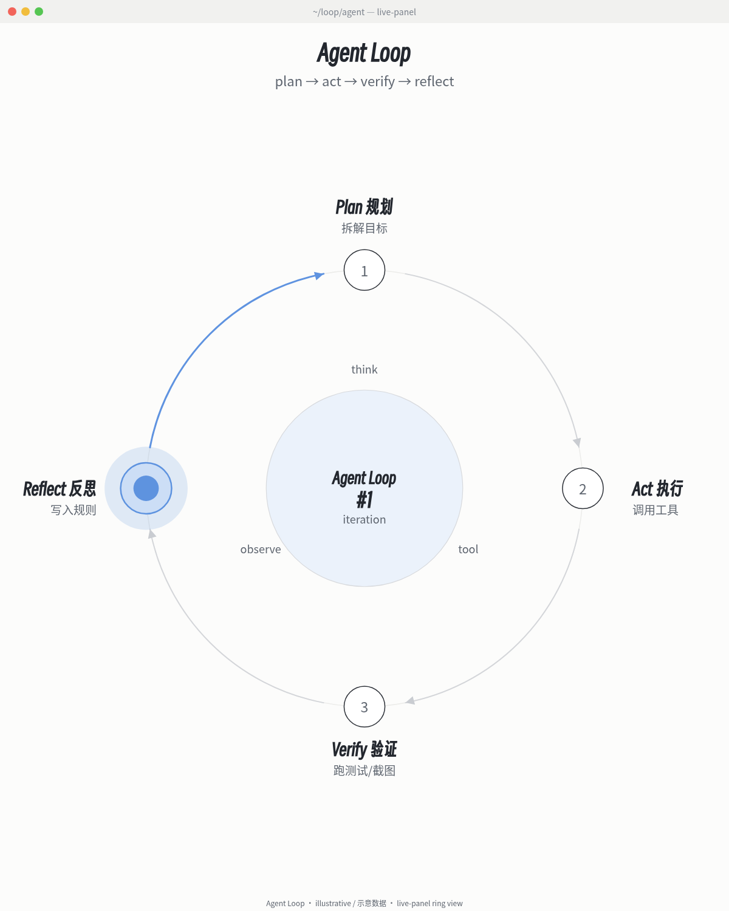
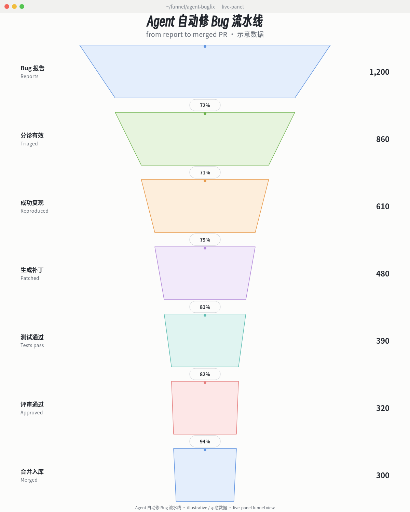

# live-panel

**English** | [中文说明](#中文说明)

Turn a system description (one JSON file) into a **terminal-style, always-running architecture diagram**, or a soft light-theme infographic that moves: fixed layout, packets flowing along the wires, a scrolling log, counters, bars that flip state, side triggers that light up in turn. Output is an H.264 mp4 (X / Xiaohongshu ready) or a live web page. It is also a Claude Code style *skill* (`SKILL.md`).

> ## Credits - please read
> - **The idea, the look and the motion grammar come from an architecture-diagram clip by [@thedelost](https://x.com/thedelost)** (a Codex agent-tree panel, generated with GPT, screen-recorded as a web page): <https://x.com/thedelost/status/2105398038026195279>. It spread via a quote-post by **[@slashui](https://x.com/slashui)**: <https://x.com/slashui/status/2105850132365443528>.
> - `examples/codex-agents/` is a **recreation of that original picture** (layout, content and the three-tempo motion, redrawn from frame captures of the clip). The design belongs to @thedelost. The method (motion grammar, config-driven template) is re-implemented here and is not their code.
> - `examples/agent-architecture/` re-animates the static Xiaohongshu infographic **《AI Agent 的完整架构》 by 小红书 @林纾** (posted Sep 4). Layout, wording and colours follow the original; the design belongs to the original author. The footer of the video says so.
> - `examples/airbnb/` visualises figures Airbnb leaders stated in the **Latent.Space interview** <https://www.latent.space/p/airbnb>. The numbers are Airbnb's own account; the animation counters are illustrative.

## What it looks like

| terminal-dark, 4:5 - recreation of @thedelost's Codex agent tree | light-pastel, 3:4 - 林纾's AI Agent architecture |
| --- | --- |
|  |  |

Airbnb example (terminal-dark, Chinese content, figures from the interview):


Videos: `examples/codex-agents/codex-agents.mp4`, `examples/agent-architecture/agent-architecture.mp4`, `examples/airbnb/airbnb.mp4` (about 28-30 s each, 30 fps, silent AAC track so chat apps do not treat them as GIFs).

## Install and use

Requirements: Python 3.8+ (standard library only), Chrome or Chromium, ffmpeg. No pip packages.

Platforms: Linux and macOS. On macOS the browser is found automatically under `/Applications` (Google Chrome, Chromium, Edge, Brave); pass `--chrome` to override. Windows is not supported natively because Chrome is driven over a DevTools pipe on POSIX file descriptors 3/4 (`pass_fds`), which Windows lacks; run the scripts unchanged inside WSL instead (`apt install chromium ffmpeg`, then render from `/mnt/c/...`).

```bash
python3 scripts/render.py --config examples/codex-agents/config.json --out out.mp4
python3 scripts/check_frames.py --config examples/codex-agents/config.json --out-dir frames --repeat
```

- `render.py` options: `--width --height --duration --fps` (default from the config), `--chrome --ffmpeg` (default: found on PATH, Chrome also under `/Applications` on macOS), `--html-out page.html` (keep the self-contained live page), `--keep-frames DIR`, `--audio none`, `--crf`.
- `check_frames.py` samples ~120 time points, measures text overflow / overlap from the DOM, writes a few PNGs and (with `--repeat`) re-renders each exported frame after seeking away to prove it is identical. Exit status 1 on any problem.
- To use as a skill, put this folder where your agent loads skills (for Claude Code: `~/.claude/skills/live-panel/`).

### Make your own

1. Copy an example config. 2. Edit text, numbers, colours, positions. 3. Render, run `check_frames.py`, look at the PNGs. Nothing in `assets/template.html` has to change.

## Views: pick a diagram shape (视图)

Besides free-form boxes and wires, a config can hold `{"type":"view","kind":...}` elements: ready-made diagram shapes that lay themselves out inside a rect, work at 4:5 / 3:4 / 1:1 and in both themes, and animate by the same motion grammar. Contract and per-view data: [`references/views.md`](references/views.md); acceptance gate: `scripts/verify_view.py` ([`references/verify-view.md`](references/verify-view.md)).

| what you want to show | view | status |
| --- | --- | --- |
| a loop that repeats (agent plan→act→verify, PDCA, release cycle) | `ring` - 3-8 steps on a circle, comet, lap counter | ready (`examples/ring/`) |
| how many survive each stage (bug→merged PR, signup→paid) | `funnel` - widths proportional to values, conversion % between stages | ready (`examples/funnel/`) |
| who relates to whom, clusters of a knowledge base or ecosystem | `nebula` - force layout by group, halos, packets on strong edges | planned |
| work over time, parallel tracks, dependencies | `timeline` - lanes, playhead, done/active/pending | planned |
| a hierarchy (agent → sub-agents → tools, org chart) | `tree` - tidy tree, expand/collapse without layout jumps | planned |
| a few numbers to watch (latency, cost, pass rate) | `kpi` - card grid, big number, sparkline cursor = shown value | planned |
| an architecture with arbitrary boxes and wires | no view: free-form `box`/`path`/`flow` elements (the three original examples) | ready |

| ring (light-pastel 4:5) | funnel (light-pastel 4:5) |
| --- | --- |
|  |  |

Each view example also has a terminal-dark 4:5 and a light-pastel 3:4 screenshot and an mp4 in its folder.

Rule of thumb: one view per picture; if the story needs two shapes, make two clips. Unlabelled numbers are illustrative and must say so on screen.

## Themes and canvas

```jsonc
"canvas": { "preset": "3:4", "duration": 28, "fps": 30, "preroll": 0 },   // or width/height explicitly
"theme":  { "preset": "light-pastel", "colors": { "pk": "#f0575f" } }      // preset + your overrides
```

| `canvas.preset` | size | typical use |
| --- | --- | --- |
| `4:5` | 1200x1500 | X (the original clip's format) |
| `3:4` | 1080x1440 | Xiaohongshu |
| `1:1` | 1080x1080 | square |

Positions in a config are absolute canvas pixels, so a config is authored for one canvas; `render.py --width/--height` only rescales (letterboxes) it. For another ratio, copy the config and re-place the boxes.

| `theme.preset` | look |
| --- | --- |
| `terminal-dark` | dark window, monospace, segmented text-mode boxes (the original clip's style) |
| `light-pastel` | white background, rounded pastel boxes, SVG arrows with rounded corners, soft glow on active items |

A theme controls: font and size, line height, the colour table (`colors`, any names you like), box mode (`segmented` or `solid`), corner radius, border width, wire width, packet size and glow, background. Add your own preset by editing `THEME_PRESETS` at the top of the boot code in the template, or override per config.

## Config reference (short)

Full tables are in [`references/config-schema.md`](references/config-schema.md).

- `elements`: `text`, `box` (fill, border colour, radius, dash, `container`, per-line `items`/`bar`/`runs`), `line`, `path` (polyline with rounded corners, arrow head, dash, `when/then` colour change, embedded packets), `glyph`, `rule`, `flow` (packets along a polyline, optional `when`), `tarrow` (trigger arrows), `log`.
- `machines` (everything that changes, all pure functions of time): `counter`, `cycle`, `gauge`, `any_low`, `lane`, `triggers`.
- `when` / `then` on boxes, paths, flows, lines and runs: highlight things from machine variables (`{"var":"seq.i","in":[0,1,2]}`; a list of conditions means AND).
- Motion rules: [`references/motion-grammar.md`](references/motion-grammar.md).

## How replay works (determinism)

The page exposes `window.seek(t)`. Every visual is a pure function of `t`; the few "random" picks use a fixed-seed integer hash; no wall clock, no `Math.random`, no CSS animation. The renderer calls `seek(i/fps)` and screenshots. In a normal browser (no `?manual`) the same function is driven by `requestAnimationFrame`.

## Fonts

No font files are bundled. The stacks fall back through installed fonts: terminal themes use JetBrains Mono (OFL) -> IBM Plex Mono (OFL) -> DejaVu Sans Mono -> Noto Sans Mono CJK SC (OFL) -> any monospace; light-pastel uses Noto Sans CJK SC (OFL) / PingFang SC / Microsoft YaHei -> Helvetica/Arial, and Noto Serif CJK SC for the big title. Install JetBrains Mono and Noto CJK for the exact look in the examples; emoji icons need a colour emoji font (e.g. Noto Color Emoji). Different fonts change glyph widths slightly, so re-run `check_frames.py` after changing fonts.

## Self-test results (this repo, Chrome 154, ffmpeg 7.1)

- All three examples rendered with `scripts/render.py`; `check_frames.py` reports 0 problems on ~120 sampled time points each. (It does catch real faults: the first Airbnb layout had a log time column overlapping the next column and was flagged.)
- Determinism: the Codex example rendered twice gives byte-identical decoded frames for all 900 frames (`ffmpeg -f framemd5` hashes equal); same for the agent-architecture example; `check_frames.py --repeat` re-screenshots after seeking away and compares bytes.
- Fidelity of the Codex recreation against frame captures of the original (side by side at the same moment): box positions and sizes within a few pixels; same four-colour code, same three-tempo behaviour (packets on every wire, trigger rotation with typed advice and `calls`/`tokens` accumulation, gauges flipping `sharp`/`split` with the legend swapping, spinners and done states, 4-row log with newest row bright, forks counter ~16/s, prompt cursor). Differences: the original's font is a slab-like monospace and ours is JetBrains Mono; the original's trigger arrows are thin solid, ours dashed; bar texture, packet glow and trails are close but not identical; the original's gauge values, log wording and timing were read by eye from 2 fps frames, so the sequences differ; the third advice text (`before done`) was not legible in the frames and is a placeholder written for this repo; log time runs at an assumed 3x.

## License

MIT for the code (see `LICENSE`). The visual design that `examples/codex-agents/` recreates belongs to @thedelost, and the infographic re-animated in `examples/agent-architecture/` belongs to 小红书 @林纾; those examples are credit-bearing recreations and are not covered by the MIT grant. Airbnb figures are Airbnb's own statements from a public interview.

---

## 中文说明

把一份系统描述（一个 JSON）变成**终端风格、一直在运行的动态架构图**，或者一张会动的浅色粉彩信息图：版面不动，连线上有光点流动，日志滚动，计数跳动，进度条过阈值翻状态，侧栏触发点依次点亮。产出 H.264 mp4（适合发 X 和小红书）或可直接打开的网页。

**出处**：动法和样式学自 [@thedelost](https://x.com/thedelost) 的 Codex agent 分工动态图（<https://x.com/thedelost/status/2105398038026195279>），经 [@slashui](https://x.com/slashui) 引用转发（<https://x.com/slashui/status/2105850132365443528>）。`examples/codex-agents/` 是对原图的复刻，设计归原作者；`examples/agent-architecture/` 把小红书 @林纾 的《AI Agent 的完整架构》静态图做成动态版，原图设计归林纾，画面底部有出处；`examples/airbnb/` 的数字出自 [Latent.Space 访谈](https://www.latent.space/p/airbnb)，为 Airbnb 自述，画面里跳动的计数为示意。

用法：`python3 scripts/render.py --config <配置> --out out.mp4`；自查：`python3 scripts/check_frames.py --config <配置> --out-dir frames --repeat`。主题用 `theme.preset`（`terminal-dark` / `light-pastel`），画幅用 `canvas.preset`（`4:5` 1200x1500、`3:4` 1080x1440、`1:1` 1080x1080）。坐标是画布像素，换画幅需要另存一份配置重排。

### 视图怎么选

| 想表达 | 用哪个视图 | 状态 |
| --- | --- | --- |
| 循环往复的流程（agent 规划→执行→验证→反思、PDCA、发版周期） | `ring` 环形 | 已完成 |
| 每一步还剩多少（Bug→合并 PR、注册→付费） | `funnel` 漏斗 | 已完成 |
| 谁和谁有关系、知识库/生态的聚类 | `nebula` 星云/关系图谱 | 待做 |
| 随时间推进、多条并行泳道、依赖 | `timeline` 时间线/泳道 | 待做 |
| 层级结构（主 agent→子 agent→工具、组织架构） | `tree` 层级树 | 待做 |
| 盯几个关键数字（延迟、成本、通过率） | `kpi` 仪表盘矩阵 | 待做 |
| 任意方框和连线的架构图 | 不用视图，自由摆放（三个原有例子） | 已有 |

一张图一个视图；要讲两件事就出两段视频。没有真实来源的数字画面上要标“示意”。验收：`python3 scripts/verify_view.py --config <配置> --chrome "$CHROME"`，7 组组合全 PASS 才算完成。
